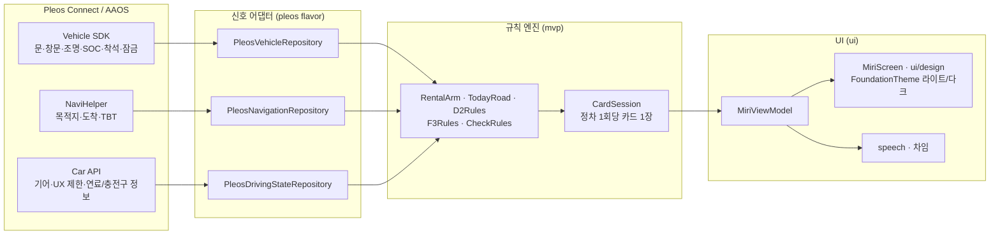

# 미리 (Miri)

**처음 타는 차, 묻기 전에 알려 주는 앱**

렌터카·카셰어링으로 낯선 차를 타는 운전자를 위한 차량용 앱입니다. Pleos Connect(AAOS)에서 동작합니다.

- 개발: 크레이지랩스 (krazylabs) · 패키지: `com.krazylabs.miri`
- 출품: 현대자동차그룹 차량용 앱 개발 공모전 2026

## 데모

**[v0.2.0-mvp 릴리스](https://github.com/dohoon84/hmg-app-challenge-2026/releases/tag/v0.2.0-mvp)**: 설치용 APK와 82초 시연 영상

## 문제와 해결

- **문제**: 처음 타는 차에서는 주유구 방향, 연료 종류, 충전 커넥터, 반납 전 점검처럼 작은 것을 몰라 당황합니다. 운전 중에는 찾아볼 수도 없습니다.
- **해결**: 미리는 차량 신호와 내비 경로를 읽고, 필요한 순간에 정차(P) 상태에서 카드 한 장으로 먼저 알려 줍니다. 주행 중에는 조작을 요구하지 않습니다.

## 핵심 기능 (이 빌드에서 동작)

| 카드 | 언제 | 무엇을 |
|---|---|---|
| F1 출발 카드 | 한동안 잠겨 있던 차의 잠금 해제 + 운전석 착석 + P | "어떤 차로 타고 계세요?" 내 차 / 렌터카 / 쉐어카 중 선택. 렌터카·쉐어카는 반납 시각을 입력(F2) |
| D1 오늘 길 | 경로가 잡힌 뒤 정차 | 경로의 톨게이트 수, 고속도로 진입 횟수 |
| D2 주유·충전 | 내비 목적지가 주유소·충전소일 때 | 전기차: 남은 배터리 %, 충전구 위치, 커넥터(DC 콤보). 내연기관차: 연료 종류, 주유구 방향 |
| F3 반납 준비 | 반납 시각이 가까울 때 (렌터카 24시간·3시간 전, 쉐어카 1시간 전) | 반납 시각에 맞춘 권장 출발 시각과 이동 시간 (경로가 없으면 남은 시간) |
| C 반납 점검 | 정차 중 열린 곳·켜진 곳이 있을 때 | 문, 트렁크, 창문, 실내등·독서등. 뒷문을 여닫았으면 뒷좌석 물건 확인 안내 |
| 차임 | D1·D2·반납 점검 카드가 열릴 때, 점검 항목이 닫히거나 점검이 끝날 때 | 짧은 알림음. 내비 안내와 겹치면 즉시 멈춤 |

미리는 차량 상태를 **읽기만** 하고 차를 제어하지 않습니다. 주행 중에는 큰 아이콘 화면만 보입니다.

### 계획

- 낯섬 감지: 이 차에 익숙하지 않은 순간을 스스로 알아차리기
- 반납 기준까지 "약 N% 더 충전/주유" 안내 (운영사 반납 기준 연동 필요)
- 반납 장소로 길 안내 (Pleos `NAVI_ROUTE_SEARCH` 권한 공개 후)
- 음성 안내 정식 적용 (기기 TTS 경로는 있으나 에뮬레이터에 TTS 엔진이 없어 지금은 차임으로 대신함)
- Vehicle Control·STT 활용 (Pleos Coming Soon)
- 렌터카·카셰어링 운영사 연동

## 아키텍처



- **신호 어댑터**: `vehicle`·`navi`·`driving` 패키지의 인터페이스(`VehicleRepository`, `NavigationRepository`, `DrivingStateRepository`)를 `pleos` flavor가 Vehicle SDK 2.3.2, NaviHelper 3.0.5, AAOS Car API로 구현합니다. Hilt로 주입합니다. `fake` flavor는 같은 인터페이스를 시뮬레이터로 채워 일반 기기에서 화면을 확인합니다.
- **세션**: `CabinSession`이 앱이 화면에 있을 때만 SDK를 연결하고, 백그라운드로 가면 해제합니다.
- **규칙 엔진**: `mvp` 패키지의 순수 Kotlin 규칙이 카드 내용을 만들고, `CardSession`이 우선순위 **C(반납 점검) > 출발 카드(F1·F2) > D2 > F3 > D1**로 한 번의 정차(P)에 카드 한 장만 고릅니다. D(주행)·R(후진)이 되면 카드를 닫습니다.
- **UI**: Jetpack Compose. `MiriViewModel` → `MiriScreen`과 `ui/design` 화면. `ui/theme`이 라이트/다크 색 토큰과 Asta Sans 서체를 제공합니다. Activity는 `distractionOptimized`이며 주행 중에는 축소 화면만 그립니다.

## 사용 권한

모두 **읽기** 권한입니다. 차량 제어(`CONTROL_*`) 권한은 쓰지 않습니다. (`app/src/pleos/AndroidManifest.xml`, Vehicle SDK 병합분)

| 권한 | 이유 |
|---|---|
| `pleos.car.permission.CAR_DOORS` | 문·트렁크 열림, 도어 잠금 (반납 점검, 출발 카드 조건) |
| `pleos.car.permission.CAR_WINDOWS` | 창문 열림 확인 (반납 점검) |
| `pleos.car.permission.CAR_ENERGY` | 연료량·배터리 % (D2 남은 %) |
| `pleos.car.permission.CAR_LIGHTS` | 실내등·독서등 켜짐 확인 (반납 점검) |
| `pleos.car.permission.CAR_DRIVE` | 적산거리 (반납 점검 후 이번 주행 거리) |
| `pleos.car.permission.CAR_INFO` | 차량 식별 번호 (끝 4자리만 저장·표시) |
| `pleos.car.permission.CAR_SEATS` | 운전석 착석 (출발 카드 조건) |
| `pleos.car.permission.NAVI_ROUTE` | 목적지·도착·경로 안내 정보 (D1·D2·F3) |
| `android.car.permission.CAR_POWERTRAIN` | 기어(P/D/R) |
| `android.car.permission.CAR_INFO` | 연료 종류, 주유구·충전구 위치, 커넥터 (D2) |
| `ai.pleos.playground.service.vehicle.VEHICLE_BINDING` | Vehicle SDK 서비스 연결 (SDK가 자동 병합) |

## 빌드·설치

JDK 17 이상, Android SDK 34. Gradle Wrapper(8.11.1)가 포함되어 있습니다.

```bash
./gradlew assemblePleosDebug                         # Pleos 에뮬레이터용 디버그 APK
./gradlew assembleFakeDebug                          # Pleos 없이 화면만 확인 (일반 기기)
./gradlew testFakeDebugUnitTest testPleosDebugUnitTest   # 단위 테스트
```

릴리스 APK 설치·실행 (Pleos Connect 에뮬레이터가 켜진 상태):

```bash
adb install -r krazylabs_miri_release.apk   # 릴리스에서 받은 APK
adb shell am start -n com.krazylabs.miri/.MainActivity
```

- 검증 환경: **Pleos Connect 에뮬레이터 (AAOS API 34)에서만** 확인했습니다. 실차에서는 아직 검증하지 않았습니다.
- 시연 영상의 주행·경로는 시뮬레이션이고, 앱 화면은 에뮬레이터 실행 화면입니다.

## 폴더 구조

```
app/src/
  main/     공통 코드: domain, mvp(규칙·CardSession), ui, speech, session, vehicle, navi, driving
  pleos/    Pleos Vehicle·NaviHelper·Car API 어댑터, 권한 매니페스트
  fake/     시뮬레이터 어댑터 (일반 기기용)
  debug/    시연용 시나리오·촬영 모드 (릴리스에 포함되지 않음)
  release/  릴리스 전용 바인딩
  test/     단위 테스트
docs/       개발 문서 (development.md), 시연 촬영 안내, MVP 설계 노트
```

빌드 변형, 촬영 모드, 신호 처리 세부 사항은 [docs/development.md](docs/development.md)를 보세요.

## 라이선스·참고

- 서체: Asta Sans, SIL Open Font License 1.1 (`app/src/main/assets/asta-sans/OFL.txt`)
- 시연 영상 BGM: "First Light Particles" by Yoiyami (OpenGameArt), CC0
- Pleos Vehicle SDK, NaviHelper: 공모전 제공 SDK
